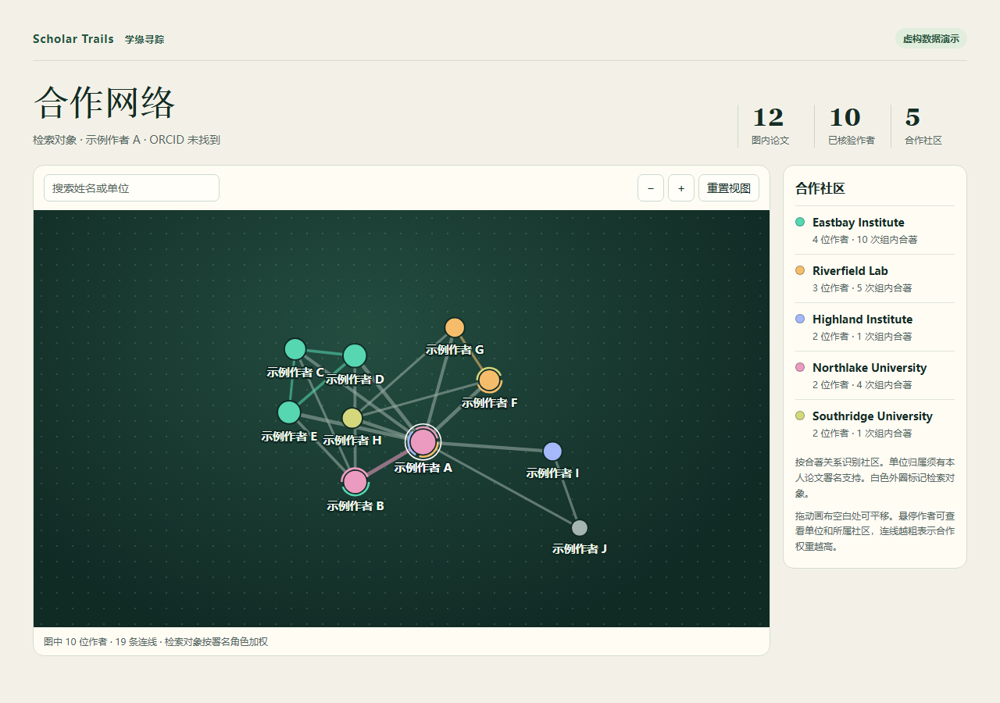

# Scholar Trails｜学缘寻踪｜学术合作检索：查学者在哪些团队做过研究、常和谁合作

> 从学者姓名出发，查找师门关系、任职团队和常合作的同行，整理公开成果并绘制合作网络。

<p align="left">
  <a href="https://github.com/peng-xiaobai/scholar-trails"></a>
  
  
</p>



## 定位

学缘寻踪用公开的研究成果梳理学术圈里的合作关系。输入学者姓名，可以查谁和他合写过论文、哪些同行经常一起做研究，以及这些合作发生在哪些单位和年份。还可以核对中英文署名，查找有公开出处的师门关系，并整理论文、专利和软件著作权。

[发布到 GitHub](docs/publish.md) · [查看参数与输出说明](skills/academic-faction-finder/references/workflow.md)

## 使用方式

把方括号换成实际的姓名、单位或期刊。手头有论文编号（DOI）或已导出的文献列表，也可以一起交给助手。

| 想做什么 | 专属 Skill | 直接这样说 |
| --- | --- | --- |
| 查合著者和合作团队 | [`academic-faction-finder`](skills/academic-faction-finder/SKILL.md) | `查 [单位] [姓名] 的合作团队，画出合著网络。` |
| 核对作者身份与机构 | [`academic-author-match`](skills/academic-author-match/SKILL.md) | `核对 [姓名] 的中英文署名，判断 [单位 A] 和 [单位 B] 的作者是不是同一人。` |
| 检索论文、专利和软著 | [`academic-output-search`](skills/academic-output-search/SKILL.md) | `查 [单位] [姓名] 的中英文论文、专利和软著，列出来源，并标出还有哪些来源没查全。` |
| 导出逐篇论文清单 | [`academic-paper-list`](skills/academic-paper-list/SKILL.md) | `导出 [单位] [姓名] 已核实的论文，含年份、作者、题名和 DOI，第一作者和通讯作者优先。` |

不确定用哪个 Skill 时，直接描述任务即可。想指定入口时，可以写 `使用 academic-author-match，核对 [姓名] 在 [单位 A] 和 [单位 B] 的署名。`

## 目录结构

```text
.gitignore
LICENSE
README.md
assets/
  preview.png
docs/
  install.md
  publish.md
skills/
  academic-faction-finder/
  academic-author-match/
  academic-output-search/
  academic-paper-list/
```

每个入口都有自己的 `SKILL.md`。配套脚本、参考说明和数据模板位于 `skills/academic-faction-finder/`。

## 适用 Agent 与安装方式

Scholar Trails 可在 **Codex** 和 **Claude Code** 中作为 Agent Skills 使用。

| Agent | 仅当前项目 | 当前用户的所有项目 | 调用示例 |
| --- | --- | --- | --- |
| Codex | `.agents/skills/` | `~/.agents/skills/` | `$academic-faction-finder` |
| Claude Code | `.claude/skills/` | `~/.claude/skills/` | `/academic-faction-finder` |

- **下载后手动安装。** 在 GitHub 的 **Releases** 下载 `scholar-trails.zip`，或通过 **Code → Download ZIP** 下载源码。解压后，把 `skills/` 下的四个目录一起复制到上表对应位置，保持同级。
- **从 Git 克隆后安装。** 运行 `git clone https://github.com/peng-xiaobai/scholar-trails.git`，再复制 `skills/` 下的四个目录。
- **用 GitHub CLI 批量安装。** 在目标 Git 项目目录运行下面的命令。使用 Claude Code 时将 `codex` 改为 `claude-code`。安装到个人目录时将 `project` 改为 `user`。

```bash
gh skill install peng-xiaobai/scholar-trails --all --agent codex --scope project
```

临时试用时，也可以让能读取本地文件的 Agent 直接读取解压目录里的 `skills/academic-faction-finder/SKILL.md`。[完整安装指南](docs/install.md)

## 运行离线演示

准备 Python 3.11 或更新版本，在仓库根目录运行。演示使用内置虚构数据，仅需 Python 标准库。

```bash
python skills/academic-faction-finder/scripts/faction_query.py --source demo --author "W. Zhang" --mode seed --min-collab 2 --out ./output/demo
```

用浏览器打开 `output/demo/network.html`。示例包含 **12 篇论文、10 位作者和 3 个合作社区**，每篇论文都有同一位虚构作者 W. Zhang。

## 使用自己的数据

1. 将 PubMed 的 `.nbib` 或标记文本交给 `collect_pubmed.py`，或将 RIS 导出交给 `collect_ris.py`。
2. 对照原始署名核实身份和角色，按[成果证据表模板](skills/academic-faction-finder/assets/research_outputs_template.csv)整理成 `evidence.csv`。每条已核实署名使用对应的 `person_id`。
3. 运行以下命令，将 `researcher-01` 换成目标作者在证据表中的 `person_id`。

```bash
python skills/academic-faction-finder/scripts/research_outputs.py --input evidence.csv --target researcher-01 --network --out ./output/researcher
```

有独立成果清单时，可加 `--reference known_outputs.csv` 对账。加 `--paper-list` 可输出论文清单。[证据字段和导出说明](skills/academic-faction-finder/references/research_outputs.md)

| 主要输出 | 内容 |
| --- | --- |
| `paper_network/network.html` | 可离线打开的交互式论文合作网络 |
| `paper_network/seed_coauthors.csv` | 目标作者的直接合著者、共同论文篇数和加权分 |
| `paper_network/faction_memberships.csv` | 每位作者所属的社区及各组的支撑文献 |
| `paper_network/affiliation_timeline.csv` | 有来源的机构经历和论文署名观察区间 |
| `typed_collaborations.csv` | 按共同作者、共同发明人、共同开发者等具名角色统计的合作记录 |

## 原理

- **谁算合作者。** 两人署名在同一篇论文上，就记一篇合著。同一篇论文在不同来源重复出现时只算一次。遇到同名作者，或同一姓名有不同中英文写法时，会结合署名单位、研究方向和公开履历核对身份。证据不足的记录留待核实。[作者身份核对规则](skills/academic-faction-finder/references/workflow.md#9-跨机构检索与归并)
- **单位怎么记录。** 保留每篇论文上写的单位，确认是同一机构的不同写法后再统一名称。一个人可以在不同时期署名不同单位，也可以在同一篇论文署名多个单位。公开履历中的任职时间和论文上出现该单位的年份分开记录。[单位与时间线规则](skills/academic-faction-finder/references/workflow.md#13-机构时间线)
- **合作分怎么算。** 对被查学者和每位合作者，先看两人在同一篇论文上的角色。独立第一作者或独立通讯作者是 3 分档，共同第一作者或共同通讯作者是 2 分档，其他署名或角色待核是 1 分档。每人取自己最高的一档，两人取较低的一档作为该篇的合作分，再把各篇加起来。例如，一人是独立第一作者，另一人是共同通讯作者，这篇合著记 2 分。其他作者彼此合作时，每篇共同论文计 1 分。[计分规则](skills/academic-faction-finder/references/workflow.md#12-署名角色与权重)
- **合作组怎么划分。** 默认从共同署名至少两篇论文的关系出发，找出经常一起写论文的作者。一个单位可以有多个合作组，一个合作组也可以横跨多个单位。一位学者与不同组都有足够的合著记录时，可以同时出现在多个组里。本项目所说的「学术派系」指这样得到的合作组。师门关系单独核对公开履历或学位论文中的导师信息。[分组规则](skills/academic-faction-finder/references/workflow.md#4-解读注意)

## 风险提醒

本仓库检索的是公开可查的论文、专利和软件著作权等成果。能查到的记录受数据来源和检索范围影响，同名作者或不完整的署名也可能影响判断。合著关系、合作分和分组结果仅供参考。引用结果或判断具体关系前，请自行检索相关成果，核对原文的作者、署名单位和发表时间。涉及师门或任职时，请再查相关公开资料。

## 数据与隐私

分发包提供通用工作流、脚本、数据模板和虚构演示。检索产生的原始导出、日志和个人资料在本地保存。对外分享检索结果前，先删除与结论无关的联系方式、个人识别号码和本机路径，只保留核验结论需要的公开出处。

## 许可证

本项目采用 MIT 许可证，允许免费使用、修改、再分发和商用。软件副本或实质部分须附带版权声明和许可文本。[MIT 许可证全文](LICENSE)
